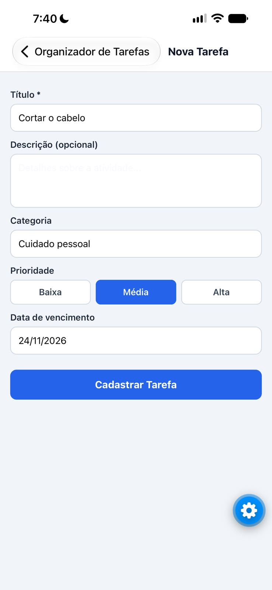

📋 Organizador de Tarefas Mobile

Aplicativo mobile multiplataforma desenvolvido em React Native com Expo e Expo Router para gestão de atividades pessoais e profissionais. O projeto foi projetado com foco em arquitetura limpa em JavaScript puro, gerenciamento de estado previsível em memória e navegação declarativa baseada em arquivos.

🎯 Funcionalidades

Dashboard em Tempo Real: Exibição automática de indicadores (total de tarefas, pendentes e concluídas) calculados diretamente a partir do estado da aplicação.

CRUD Completo de Tarefas:

Cadastro: Criação de tarefas com título obrigatório, descrição opcional, categoria, nível de prioridade (baixa, média ou alta) e data de vencimento.

Listagem Otimizada: Renderização via FlatList com diferenciação visual clara entre itens pendentes e concluídos, além de alternância rápida de status.

Detalhes Dinâmicos: Visualização completa das informações da atividade através de rotas parametrizadas (/detalhes/[id]).

Edição: Atualização isolada apenas da tarefa selecionada (/editar/[id]) reutilizando o componente de formulário.

Exclusão Segura: Remoção com diálogo nativo de confirmação (Alert) antes de excluir o registro.

Filtros Combinados: Filtragem por status (Todas, Pendentes, Concluídas) e por prioridade (Alta, Média, Baixa) sem mutar a lista original.

🛠️ Tecnologias e Conceitos Aplicados

Core: React Native, Expo SDK e JavaScript (ES6+).

Navegação: Expo Router (Stack Navigation, rotas dinâmicas [id], Link, useRouter, useLocalSearchParams).

Gerenciamento de Estado: React Context API + useState com atualizações funcionais imutáveis, sem uso de bibliotecas externas ou persistência local (armazenamento em memória).

Manipulação de Dados: Uso intensivo de métodos funcionais (map, filter, find, reduce), destructuring e spread operator.

Componentização: Arquitetura modular com reaproveitamento de UI (TaskForm, TaskItem, CardContainer com children e spread props, IndicadorBox).

## 📸 Telas do Aplicativo

| Página Inicial | Nova Tarefa | Detalhes da Tarefa | Tarefa Concluída |
| :---: | :---: | :---: | :---: |
|  |  |  |  |

📂 Estrutura do Projeto

organizador-tarefas/
├── assets/                 # Ícones e imagens estáticas do aplicativo
└── src/
    ├── app/                # Rotas e telas gerenciadas pelo Expo Router
    │   ├── _layout.js      # Configuração da Stack Navigation e Provider global
    │   ├── index.js        # Dashboard, indicadores, filtros e FlatList
    │   ├── cadastro.js     # Tela de criação de nova tarefa
    │   ├── detalhes/
    │   │   └── [id].js     # Tela de detalhes, conclusão e exclusão
    │   └── editar/
    │       └── [id].js     # Tela de edição de tarefa existente
    ├── components/         # Componentes de interface reutilizáveis
    │   ├── CardContainer.js
    │   ├── IndicadorBox.js
    │   ├── TaskForm.js
    │   └── TaskItem.js
    └── context/
        └── TasksContext.js # Estado em memória e regras de negócio

🚀 Como Executar o Projeto

Pré-requisitos

Node.js (versão LTS recomendada: >= 22.13.0)

Aplicativo Expo Go instalado no dispositivo físico (iOS/Android) ou emulador configurado

Passo a passo

# 1. Clone o repositório
git clone https://github.com/CaioSMoura/Organizador-tarefas.git

# 2. Acesse a pasta do projeto
cd Organizador-tarefas

# 3. Instale as dependências
npm install

# 4. Inicie o servidor de desenvolvimento Expo
npx expo start

Após iniciar, escaneie o QR Code exibido no terminal utilizando a câmera do iPhone (ou o app Expo Go no Android).

👨‍💻 Autor

Desenvolvido por Caio Moura — GitHub